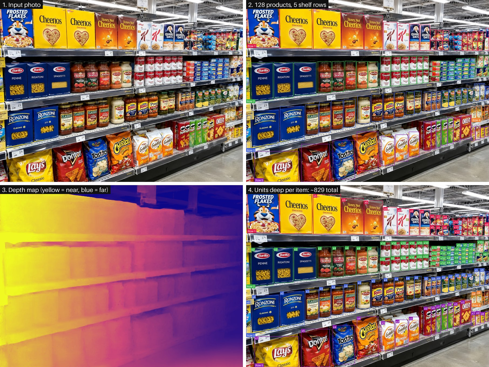
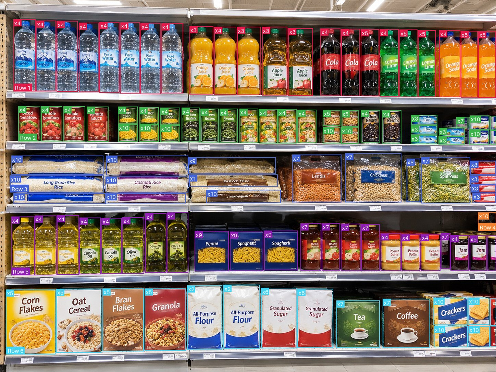
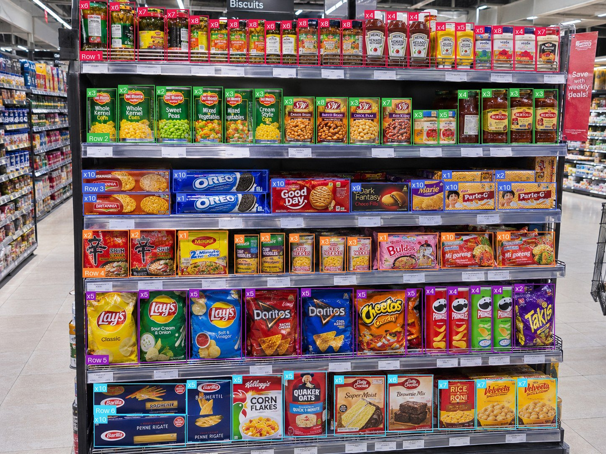

# 🛒 Shelf Item Counter

Upload a photo of a retail shelf. The app finds every visible product, groups the products
by shelf row, and uses monocular depth estimation to estimate how many units stand
**behind** each one. The output is a total stock estimate, not just a count of what you
can see.



## Features

- **Dense product detection.** A YOLO11 detector trained on
  [SKU-110K](https://docs.ultralytics.com/datasets/detect/sku-110k/) runs on the whole
  photo and on overlapping tiles, so small, tightly packed items are found too.
- **Shelf rows.** Products standing on one shelf share a bottom edge, so each box is
  chained to its neighbours. This works on angled photos where shelves slant, and keeps
  stacked layers on the same shelf.
- **Depth-aware stock estimate.**
  [Depth Anything V2](https://huggingface.co/depth-anything/Depth-Anything-V2-Metric-Indoor-Small-hf)
  measures the distance to each product. CLIP labels its shape (can, jar, bottle, box or
  bag). The two together give the product's real depth, and from that, how many units fit
  on the shelf behind it.
- **Dashboard.** Upload several photos at once, see annotated images, per-row tables and
  the depth map, and export everything to CSV.

## Examples

Each box is labelled `xN`: the estimated number of units in that product's lane, front to
back. Colours mark shelf rows.

| | |
|---|---|
|  |  |
| 111 products, 6 rows, ~641 units | 82 products, 6 rows, ~442 units |

The sample photos in [`samples/`](samples) are AI-generated store images, so you can try
the app straight away.

## Quick start

Requires Python 3.9 or newer.

```bash
git clone https://github.com/armanmirnoori/shelf-counter.git
cd shelf-counter

python -m venv .venv                  # Windows: py -m venv .venv
source .venv/bin/activate             # Windows: .venv\Scripts\activate
pip install -r requirements.txt

streamlit run app.py
```

Open http://localhost:8501 and upload a photo, or one from [`samples/`](samples).

The first run downloads about 500 MB of model weights and loads them into memory, which
can take a few minutes. After that, a new photo takes about 20 seconds on a laptop CPU.

## Settings

| Setting | What it does |
|---|---|
| **Model** | The SKU-110K shelf detector (default), or open-vocabulary YOLO-World for other scenes and custom text prompts. |
| **Detection confidence** | Lower finds more items but adds false positives. |
| **Tiling** | Also scans 2×2 or 3×3 overlapping crops. Finds small items; slower. |
| **Shelf depth (cm)** | Front-to-back depth of your shelves. Set it to the real value. |
| **Tallest product in photo (cm)** | Calibrates real-world sizes (a cereal box is about 30 cm, a soup can about 10 cm). |

## How it works

```
photo ─► YOLO11 (SKU-110K) + tiling ─► cleanup ─► shelf rows ─┐
     ├─► CLIP shape label per product ────────────────────────┼─► units deep per product ─► totals
     └─► Depth Anything V2 depth map ─────────────────────────┘
```

1. **Detect.** Run the detector on the full photo and on overlapping tiles. Drop boxes cut
   by a tile edge, merge duplicates, and remove boxes that wrap several products.
2. **Group rows.** Link each product to its nearest left-hand neighbours whose bottom
   edges line up, and to any product stacked directly on top of it.
3. **Measure.** Distance per product = median depth inside its box. Pixel sizes become
   real sizes, calibrated so the tallest products match *Tallest product*.
4. **Estimate depth.** Round products are as deep as they are wide; boxes and bags are
   about a quarter as deep as they are tall. A product pushed back from the shelf front
   has less room behind it, so that gap is subtracted.
5. **Count.** Units deep = usable shelf depth ÷ product depth. Total = sum over products.

The logic lives in [`counter.py`](counter.py); the dashboard is [`app.py`](app.py).

## Limitations

- **Hidden units are estimated, not seen.** A photo cannot show what is behind the front
  row. The estimate assumes shelves are stocked to the back, and depends on the *Shelf
  depth* and *Tallest product* settings. Validate it against a manual count before
  relying on it.
- **Clutter can be detected as products.** Patterned backgrounds such as brick walls
  sometimes produce false boxes; see the top right of
  [this example](docs/result_3.jpg). Raise the confidence or crop the photo.
- **Licence of the detector weights.** The default detector
  ([chistopat/sku110k-yolo11-object-detector](https://huggingface.co/chistopat/sku110k-yolo11-object-detector))
  is trained on SKU-110K, which is released for academic and non-commercial use. For
  commercial use, train a detector on your own shelf photos and point `SKU_REPO` /
  `SKU_FILE` in `counter.py` at it.
- **Speed.** Everything runs on CPU by default. With a CUDA build of PyTorch, the depth
  and CLIP steps are much faster.

## Built with

[Ultralytics YOLO](https://github.com/ultralytics/ultralytics) ·
[Depth Anything V2](https://github.com/DepthAnything/Depth-Anything-V2) ·
[OpenAI CLIP](https://github.com/openai/CLIP) ·
[Streamlit](https://streamlit.io)
